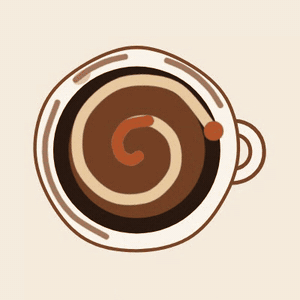
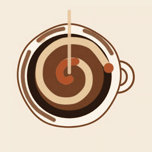
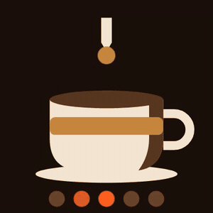
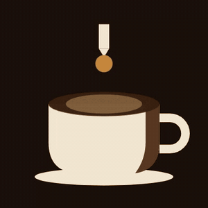
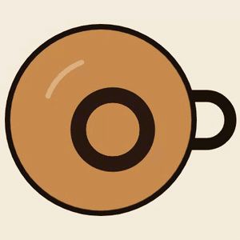
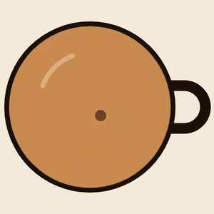
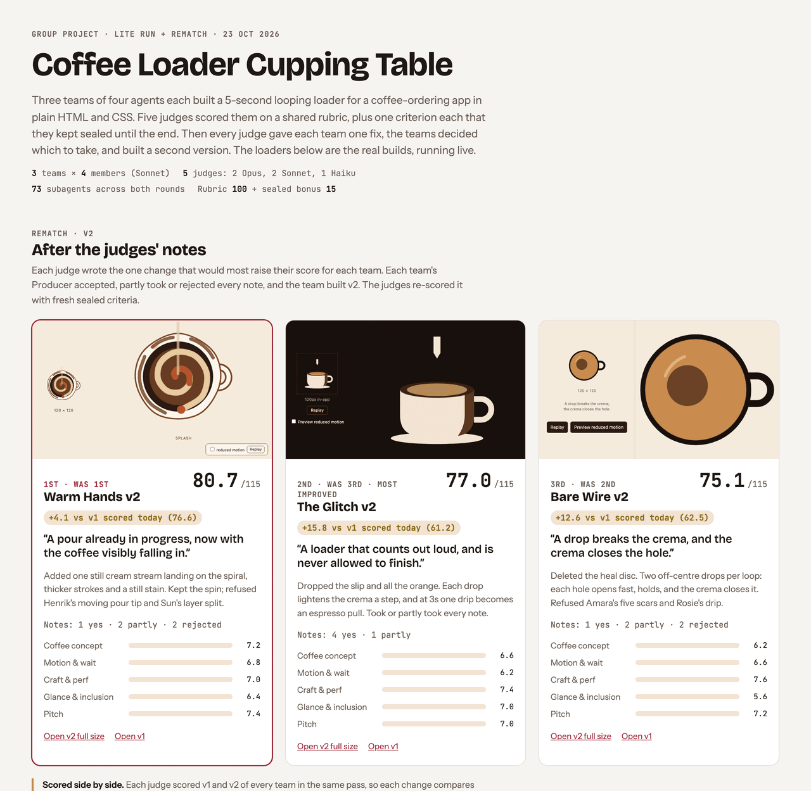

<p align="center">
  
</p>

<h3 align="center">Don't ask one model for one answer. Run a hackathon.</h3>

<p align="center">
  A Claude Code skill that turns one idea into 3-5 finished, competing variations.<br>
  Teams of agents with clashing personalities argue their way to a build and a pitch.<br>
  A panel of expert judges scores them, and each judge keeps one criterion secret until the reveal.
</p>

<p align="center">
  <a href="#install">Install</a> ·
  <a href="#see-it-work-a-coffee-app-loader">See it work</a> ·
  <a href="#how-a-run-works">How it works</a> ·
  <a href="#the-feedback-loop">The rematch</a>
</p>

---

## See it work: a coffee-app loader

One brief: *a 5-second looping loading indicator for a coffee-ordering app, in plain HTML and CSS.* Three teams, three temperaments, no creative direction given. These are their real builds, before and after the judges' notes.

<table>
  <tr>
    <th></th>
    <th>Round 1</th>
    <th>Rematch, after the judges' notes</th>
  </tr>
  <tr>
    <td valign="top" width="28%">
      <b>Warm Hands</b><br><sub>Humanists</sub><br><br>
      <i>"Every other loader makes you wait. This one is already pouring."</i><br><br>
      🥇 Won round 1 · 86.2<br>
      Rematch: <b>+4.1</b><br><br>
      <sub>All five judges said the spiral read as a spinner. The team took the cream stream, refused two rebuilds, and said why.</sub>
    </td>
    <td></td>
    <td></td>
  </tr>
  <tr>
    <td valign="top">
      <b>The Glitch</b><br><sub>Provocateurs</sub><br><br>
      <i>"A loader that counts out loud, and is never allowed to finish."</i><br><br>
      Last in round 1 · 65.5<br>
      Rematch: <b>+15.8, most improved</b><br><br>
      <sub>Every judge's note went after the glitch or the orange. The team cut both and moved the provocation into the coffee itself.</sub>
    </td>
    <td></td>
    <td></td>
  </tr>
  <tr>
    <td valign="top">
      <b>Bare Wire</b><br><sub>Purists</sub><br><br>
      <i>"A drop breaks the crema, and the crema closes the hole."</i><br><br>
      2nd in round 1 · 73.5<br>
      Rematch: <b>+12.6</b><br><br>
      <sub>Two judges caught the v1 pitch claiming an effect the code didn't draw. v2 builds what it says.</sub>
    </td>
    <td></td>
    <td></td>
  </tr>
</table>

Every file from the run is in [`group-project-runs/coffee-loader-20261023/`](group-project-runs/coffee-loader-20261023/): each team's debate log, plans, builds, the judges' sealed criteria, their notes and every score.

### The scoreboard

Each run can produce a shareable gallery: live loaders, the score sheet, every sealed criterion opened, and whether each judge's note landed.

<p align="center">
  <picture>
    <source media="(prefers-color-scheme: dark)" srcset="assets/scoreboard-dark.png">
    
  </picture>
</p>

---

## How a run works

<p align="center">
  
</p>

**The judges come first.** Five judges are cast for the domain: 2 on Opus, 2 on Sonnet, and 1 on Haiku, who plays an everyday user's gut reaction. Each seals one criterion they care about more than the rubric does. The Head Judge publishes the goal and rubric, and announces that the secret criteria exist without saying what they are.

**Every team gets the same four roles and a different temperament.**

| Role | Job |
|---|---|
| **Visionary** | The creative. Refuses anything generic, and drafts the pitch. |
| **Producer** | Makes the call, owns the plan, and cuts every claim the build doesn't back up. |
| **Skeptic** | Finds the fatal flaw in every idea, including their own, and red-teams the build. |
| **Craftsperson** | Builds the real thing: files you can open, not a description of files. |

Each member also gets a name, a personality, taste anchors and a blind spot that teammates are expected to catch. Teams are never told what to make. Their temperament (Purists, Humanists, Provocateurs...) and their people decide it.

**The friction is real.** Members propose alone, then attack each other's ideas. If a team agrees too easily, the next round tells the Skeptic and Visionary to escalate. In the example run, Skeptics caught a contrast failure, a bug in their own team's plan, and a glitch that read as the app breaking.

**Judging is independent.** Every judge scores alone on their own model. `scripts/tally.py` validates every score file, totals rubric and secret-criterion points, and reports where the judges disagreed most.

## The feedback loop

After the reveal, each judge writes **the one change that would most raise their score** for every team. The teams decide what to do with each note:

- **Accept** it,
- **Reject** it with a reason (a reason that holds isn't penalised), or
- **Steal** one idea from a rival's build, credited.

The Skeptic attacks that triage from both sides: notes taken just to please a judge, and notes refused out of pride. Then the team builds v2.

**The judges score v1 and v2 side by side, in the same pass.** That turned out to matter. In the example, after writing their notes, the judges graded the same v1 builds 4 to 11 points harder than in round 1. Comparing v2 with the old round-1 score made Warm Hands look like it got 5 points worse. Paired, it got 4 points better.

Every run also appends what it learned to [`lessons.md`](group-project/lessons.md). The Head Judge reads the lessons on what wins in that domain; teams only ever see the process lessons, so no run simply copies the last winner.

---

## Install

```bash
git clone https://github.com/rader-ai/hackathon-skill.git
ln -s "$PWD/hackathon-skill/group-project" ~/.claude/skills/group-project
```

For animated work, the builders and judges look at frames through `scripts/capture.mjs`, which needs `ffmpeg` and Playwright:

```bash
npm install --prefix ~/.cache/group-project playwright
```

Then ask Claude Code for a group project:

```text
/group-project a 5-second loading animation for a coffee-ordering app
```

Or just say "run a hackathon on…", "have teams compete on…", or "I want variations of…". It works for motion graphics, design languages, video concepts, product ideas, brand identities, and anything else where you want genuinely different takes rather than A/B tweaks.

### Settings

| Setting | Default |
|---|---|
| Teams | 4 (3-5) |
| Team size | 4 (3-5; 5 adds a Wildcard from an unrelated field) |
| Mode | `standard`, or `lite` to skip the second clash and the judges' Q&A |
| Rematch | offered after the reveal |

### Cost

These are subagent calls, not tokens. The skill tells you the mode and team count before Round 1.

| Run | Calls |
|---|---|
| `lite`, 3 teams × 4 | about 50 (the example used 51) |
| `standard`, 4 teams × 4 | about 60-70 |
| Rematch, 3 teams | about 22 more |

## What's inside

```
group-project/                 the skill
  SKILL.md                     the Host's playbook
  lessons.md                   what earlier runs learned
  references/                  roles, judges, rubric, every prompt
  scripts/tally.py             scoring for round 1 and rematches
  scripts/capture.mjs          frames and GIFs of animated builds, for builders and judges
group-project-runs/
  coffee-loader-20261023/      the example run, every file
assets/                        README visuals
```

## Status

**Tested:** `lite` mode, 3 teams of 4, one domain (UI motion), the rematch with paired re-scoring, and the scoring script.

**Not yet tested:** `standard` mode and the Q&A round, 4-5 teams, team sizes 3 and 5, the Wildcard role, and any domain other than UI motion.

Issues and run reports are welcome.
