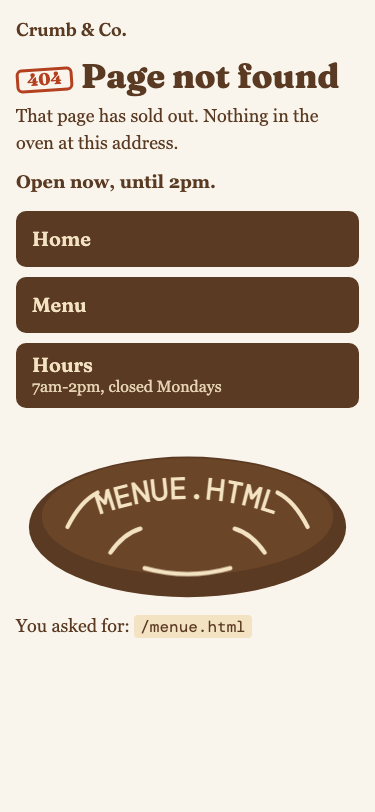
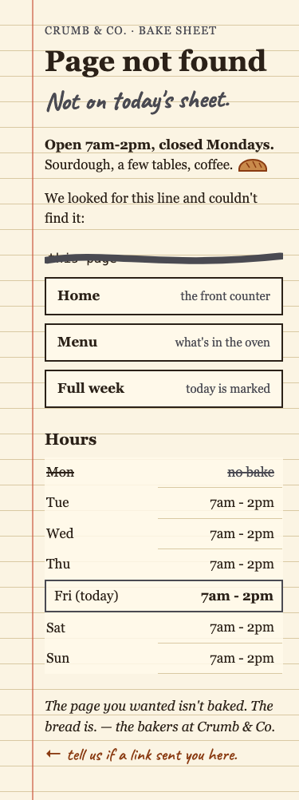
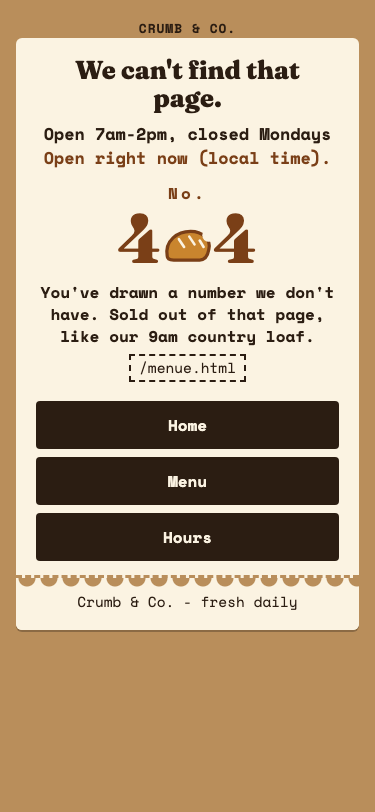

<p align="center">
  
</p>

<h3 align="center">One brief in. Several finished ideas out, graded.</h3>

<p align="center">
  You have something to get done. Group Project sets up a hackathon for it.<br>
  It spins up groups of agents, each group builds its own version, judges grade them,<br>
  and you get back finished, ranked ideas instead of one answer.
</p>

<p align="center">
  <a href="#install">Install</a> ·
  <a href="#latest-a-full-hackathon-in-under-10-minutes">Latest</a> ·
  <a href="#see-it-work-a-coffee-app-loader">See it work</a> ·
  <a href="#how-a-run-works">How it works</a> ·
  <a href="#the-feedback-loop">The rematch</a>
</p>

---

## Latest: a full hackathon in under 10 minutes

Runs now keep to a clock. Every agent has a timebox, groups move at their own pace after they decide, and the Host stops anything that runs long. A timed `lite` run (3 groups of 4, 5 judges) on a small brief, a bakery's "page not found" page, went from brief to ranked results in **9 min 50 s**. The run before the change took 56 minutes.

| Phase | Deadline | Finished |
|---|---|---|
| Setup: judges, brief, groups | 1:30 | 0:59 |
| Propose, clash, decide | 5:30 | 5:26 |
| Build, review, fix | 12:30 | 7:33 |
| Pitch, judging, tally | 16:00 | 9:50 |

<table>
  <tr>
    <th>1st · Group B · 84.8</th>
    <th>2nd · Group C · 83.2</th>
    <th>3rd · Group A · 82.6</th>
  </tr>
  <tr valign="top">
    <td></td>
    <td></td>
    <td></td>
  </tr>
  <tr valign="top">
    <td><sub>"Every other 404 hides your typo. Ours bakes it into a loaf." Won on concept; two judges said the loaf reads as a frown.</sub></td>
    <td><sub>The missing page is a line crossed off the morning bake sheet. Most useful hours, best keyboard path.</sub></td>
    <td><sub>"You've drawn a number we don't have." The leanest page (3.7 KB), and it still works with JavaScript off.</sub></td>
  </tr>
</table>

Only 2.2 points separate first from last. Clock, scores and every judge's note are in [`group-project-runs/bakery-404-20261023/`](group-project-runs/bakery-404-20261023/).

## See it work: a coffee-app loader

The brief: *a 5-second looping loading indicator for a coffee-ordering app, in plain HTML and CSS.* Three groups got it, with no creative direction. These are their real builds, before and after the judges' notes.

<table>
  <tr>
    <th></th>
    <th>Round 1</th>
    <th>Rematch, after the judges' notes</th>
  </tr>
  <tr>
    <td valign="top" width="28%">
      <b>Group A</b><br><sub>Warm Hands · Humanists</sub><br><br>
      <i>"Every other loader makes you wait. This one is already pouring."</i><br><br>
      🥇 Won round 1 · 86.2<br>
      Rematch: <b>+4.1</b><br><br>
      <sub>All five judges said the spiral read as a spinner. The group took the cream stream, refused two rebuilds, and said why.</sub>
    </td>
    <td></td>
    <td></td>
  </tr>
  <tr>
    <td valign="top">
      <b>Group B</b><br><sub>The Glitch · Provocateurs</sub><br><br>
      <i>"A loader that counts out loud, and is never allowed to finish."</i><br><br>
      Last in round 1 · 65.5<br>
      Rematch: <b>+15.8, most improved</b><br><br>
      <sub>Every judge's note went after the glitch or the orange. The group cut both and moved the provocation into the coffee itself.</sub>
    </td>
    <td></td>
    <td></td>
  </tr>
  <tr>
    <td valign="top">
      <b>Group C</b><br><sub>Bare Wire · Purists</sub><br><br>
      <i>"A drop breaks the crema, and the crema closes the hole."</i><br><br>
      2nd in round 1 · 73.5<br>
      Rematch: <b>+12.6</b><br><br>
      <sub>Two judges caught the v1 pitch claiming an effect the code didn't draw. v2 builds what it says.</sub>
    </td>
    <td></td>
    <td></td>
  </tr>
</table>

Every file from the run is in [`group-project-runs/coffee-loader-20261023/`](group-project-runs/coffee-loader-20261023/): each group's debate log, plans, builds, the judges' sealed criteria, their notes and every score.

### The scoreboard

Each run can produce a shareable gallery: live loaders, the score sheet, every sealed criterion opened, and whether each judge's note landed.

<p align="center">
  <picture>
    <source media="(prefers-color-scheme: dark)" srcset="assets/scoreboard-dark.png">
    
  </picture>
</p>

---

## How a run works

<p align="center">
  
</p>

**The judges come first.** One panel designer casts five judges for the domain: 2 on Opus, 2 on Sonnet, and 1 on Haiku, who plays an everyday user's gut reaction. It gives each judge one sealed criterion they care about more than the rubric does, all five distinct, and publishes the goal and rubric, saying the secret criteria exist without saying what they are.

**Every group gets the same four roles and a different temperament.** (Inside the skill's files, groups are called teams.)

| Role | Job |
|---|---|
| **Visionary** | The creative. Refuses anything generic, and drafts the pitch. |
| **Producer** | Makes the call, owns the plan, and cuts every claim the build doesn't back up. |
| **Skeptic** | Finds the fatal flaw in every idea, including their own, and red-groups the build. |
| **Craftsperson** | Builds the real thing: files you can open, not a description of files. |

Each member also gets a name, a personality, taste anchors and a blind spot that groupmates are expected to catch. Groups are never told what to make. Their temperament (Purists, Humanists, Provocateurs...) and their people decide it.

**The friction is real.** Members propose alone, then attack each other's ideas. If a group agrees too easily, the next round tells the Skeptic and Visionary to escalate. In the example run, Skeptics caught a contrast failure, a bug in their own group's plan, and a glitch that read as the app breaking.

**Judging is independent.** Every judge scores alone on their own model. `scripts/tally.py` validates every score file, totals rubric and secret-criterion points, and reports where the judges disagreed most.

## The feedback loop

After the reveal, each judge writes **the one change that would most raise their score** for every group. The groups decide what to do with each note:

- **Accept** it,
- **Reject** it with a reason (a reason that holds isn't penalised), or
- **Steal** one idea from a rival's build, credited.

The Skeptic attacks that triage from both sides: notes taken just to please a judge, and notes refused out of pride. Then the group builds v2.

**The judges score v1 and v2 side by side, in the same pass.** That turned out to matter. In the example, after writing their notes, the judges graded the same v1 builds 4 to 11 points harder than in round 1. Comparing v2 with the old round-1 score made Warm Hands look like it got 5 points worse. Paired, it got 4 points better.

Every run also appends what it learned to [`lessons.md`](group-project/lessons.md). The Head Judge reads the lessons on what wins in that domain; groups only ever see the process lessons, so no run simply copies the last winner.

---

## Install

```bash
git clone https://github.com/rader-ai/hackathon-skill.git
ln -s "$PWD/hackathon-skill/group-project" ~/.claude/skills/group-project
```

For animated work, the builders and judges look at frames through `scripts/capture.mjs`, which needs `ffmpeg` and Playwright:

```bash
npm install --prefix ~/.cache/group-project playwright
```

Then ask Claude Code for a group project:

```text
/group-project a 5-second loading animation for a coffee-ordering app
```

Or just say "run a hackathon on…", "have teams compete on…", or "I want variations of…". It works for motion graphics, design languages, video concepts, product ideas, brand identities, and anything else where you want genuinely different takes rather than A/B tweaks.

### Settings

| Setting | Default |
|---|---|
| Groups | 4 (3-5) |
| Group size | 4 (3-5; 5 adds a Wildcard from an unrelated field) |
| Mode | `lite` (~15 min), or `standard` for a second clash, judges' Q&A and a bigger build (~25 min) |
| Rematch | offered after the reveal |

### Time and cost

Every agent works to a timebox, groups move at their own pace after the decision round, and the Host stops anything far over budget, so a run keeps to a clock. The skill tells you the mode, group count and expected time before it starts.

| Run | Time | Subagent calls |
|---|---|---|
| `lite`, 3 groups × 4 | ~15 min (measured: 9 min 50 s) | about 45 |
| `standard`, 4 groups × 4 | ~25 min | about 80 |
| Rematch, 3 groups | ~10 min more | about 22 more |

## What's inside

```
group-project/                 the skill
  SKILL.md                     the Host's playbook
  lessons.md                   what earlier runs learned
  references/                  roles, judges, rubric, every prompt
  scripts/tally.py             scoring for round 1 and rematches
  scripts/capture.mjs          frames and GIFs of animated builds, for builders and judges
group-project-runs/
  coffee-loader-20261023/      the example run, with the rematch
  readme-showcase-20261023/    a run that built a README skill
  bakery-404-20261023/         the timed 10-minute run
assets/                        README visuals
```

## Status

**Tested:** `lite` mode with 3 groups of 4, the 15-minute clock, the rematch with paired re-scoring, the scoring script, and three domains: UI motion, a Claude Code skill, and a web page.

**Not yet tested:** `standard` mode and the Q&A round, 4-5 groups, group sizes 3 and 5, the Wildcard role, and domains beyond those three.

Issues and run reports are welcome.
