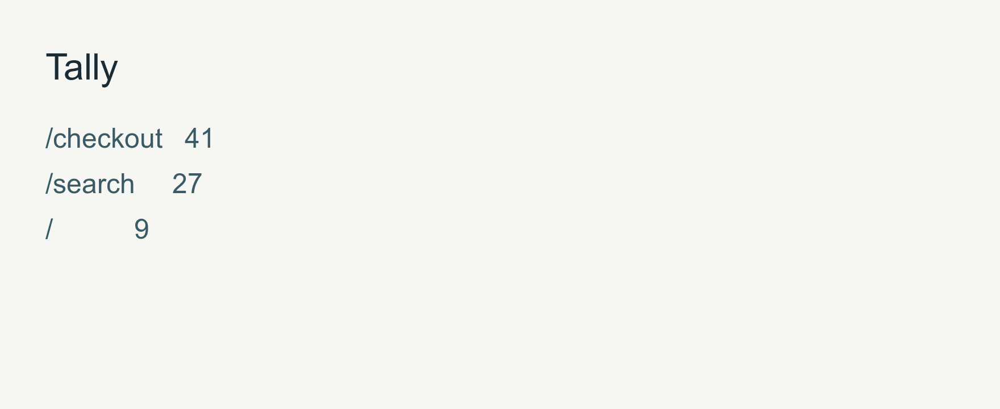

# Tally

Tally turns a web access log into a ranked list of the paths that get the most hits, so you can see where traffic goes without a dashboard.

```bash
python3 tally.py count examples/sample.log --top 3
```

```text
/checkout   41
/search     27
/           9
```

<picture>
  <source media="(prefers-color-scheme: dark)" srcset="assets/report-dark.png">
  
</picture>

## Requirements

Python 3.9 or newer. Standard library only.

## HTML table

```bash
python3 tally.py report examples/sample.log --output out/sample-report.html
```

The command writes `out/sample-report.html`. The usage notes are in [docs/USAGE.md](docs/USAGE.md). Run `python3 -m unittest discover -s tests` for the tests.

## License

MIT
