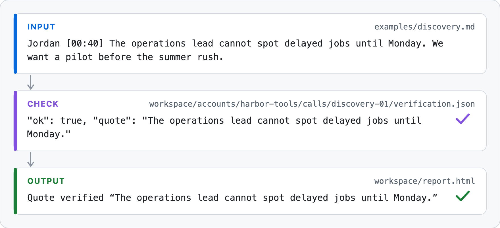
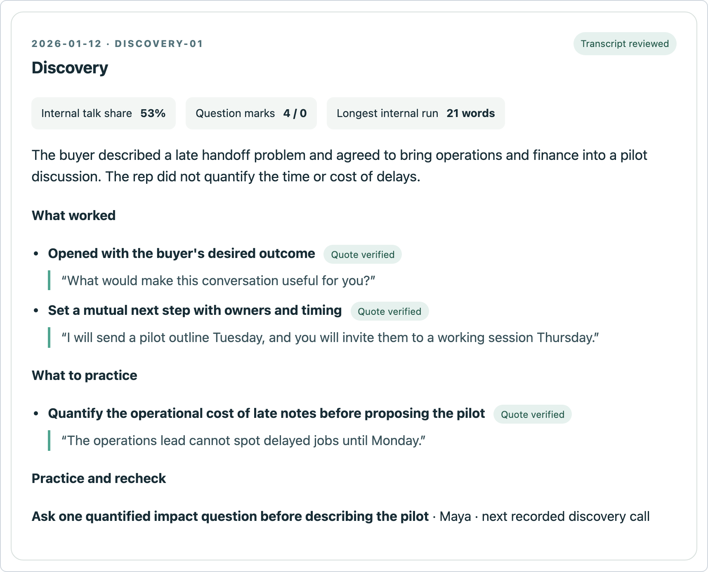

# Call Review Lab

Turn a pile of sales or customer calls into an account timeline, evidence checked observations, and a coaching report.

<picture>
  <source media="(prefers-color-scheme: dark)" srcset="assets/reel-dark.svg">
  <source media="(prefers-color-scheme: light)" srcset="assets/reel-light.svg">
  
</picture>

Requires Python 3.10 or newer. The core workflow uses only the standard library.

```bash
git clone https://github.com/rader-ai/sales-call-review.git
cd sales-call-review
python3 run.py demo
open workspace/report.html           # macOS
# xdg-open workspace/report.html     # Linux
```

## What it does

The demo imports a synthetic discovery call, a later unrecorded meeting, and a sample analysis. It generates `workspace/report.html`, which is local and ignored by git. Calls without recordings stay in the timeline so gaps remain visible. All accounts, speakers, quotes, and dates in `examples/` are invented.

The report below is example output, captured from the repo's `workspace/report.html` (synthetic data).



Question marks 4 / 0 is the internal count, then the external count. Numbers count words and question marks in speaker labeled transcripts. They do not measure speaking time or question quality.

Run `python3 -m unittest discover -s tests` to check the core logic.

## Who it fits

It starts from transcripts from any source. No HubSpot account or API key is needed. Review the report with the account owner before using it for coaching.

## Use it with your own calls

1. Obtain recordings or transcripts with permission. Redact sensitive material before using an external model.
2. Convert a transcript into Markdown turns: `**Speaker Name** [mm:ss] Spoken text`.
3. Import a call and build the report:

```bash
python3 run.py init
python3 run.py add \
  --account "Example Account" --id "discovery-01" \
  --date "2026-01-12" --title "Discovery" \
  --internal "Rep Name" --external "Buyer Name" \
  --transcript /path/to/reviewed-transcript.md
python3 run.py report
```

For many calls, use `python3 run.py import-csv /path/to/calls.csv`. The CSV columns are `account,id,date,title,internal,external,transcript,recorded,source`.

4. Review the measured statistics with `python3 run.py review`. The calculation counts words and question marks from the labeled transcript. Unknown speakers are excluded from talk share.
5. For qualitative analysis, use [the analyst prompt](prompts/analyze_call.md) with the reviewed transcript, `meta.json`, and any earlier analyses for that account. Save the result as `workspace/accounts/<account>/calls/<id>/analysis.json`.

Optional local transcription: install `ffmpeg` and [whisper.cpp](https://github.com/ggml-org/whisper.cpp) separately, put a compatible model on your computer, then run:

```bash
python3 run.py transcribe --media /path/to/call.mp4 \
  --model /path/to/ggml-model.bin \
  --output /path/to/call.txt --language en --threads 4
```

This only creates a raw text transcript. It does not identify speakers.

## How it works

| Stage | Purpose | Output |
| --- | --- | --- |
| Timeline | Group calls by account and include missing recordings | Call coverage |
| Deterministic measures | Count words, question marks, and longest internal run | `metrics.json` |
| Evidence based analysis | Ask what worked, what to practice, and what is still unknown | `analysis.json` |
| Quote verification | Check each quote within one speaker turn | `verification.json` |
| Owner review | Reconcile the call with deal context and outcomes | Human coaching decisions |

Every quote in the analysis is checked against a single speaker turn. Unsupported quotes are flagged and hidden from the visible evidence.

## Privacy

The Python commands run locally and make no model API calls. If you paste transcripts into a cloud coding agent or model, that provider processes the content under its own terms. Reports contain call content and belong in an access controlled location.

## Limits

- This is a review aid, not a performance verdict.
- A question mark count is not a measure of good discovery.
- It does not silently infer deal outcomes, automatically fetch CRM data, or automate model analysis.
- A git ignore rule is not access control.
- Review the report with the account owner before using it for coaching.

## License

MIT licensed. Created by Chris Rader.

Commands other than `python3 run.py demo` are copied from the repo's README and were not run for this page (unverified).
