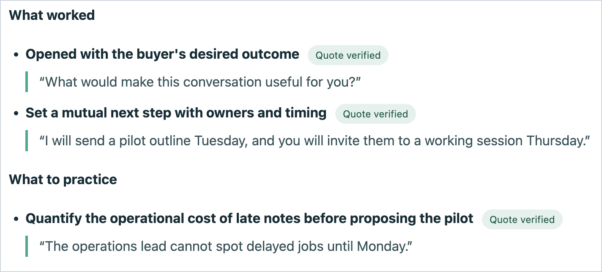

# Call Review Lab

For people who review sales or customer calls: turns transcripts into an account timeline, evidence checked observations, and a coaching report. A quote is tagged "Quote verified" only if its words (ignoring case and punctuation) appear inside one speaker turn of the transcript.

Three lines from `examples/discovery.md`:

```
**Maya** [00:00] Thanks for joining. What would make this conversation useful for you?
**Jordan** [00:40] The operations lead cannot spot delayed jobs until Monday. We want a pilot before the summer rush.
**Maya** [01:40] Great. I will send a pilot outline Tuesday, and you will invite them to a working session Thursday. Does that fit?
```



*Crop of `workspace/report.html`, produced by `python3 run.py demo` from the synthetic data in `examples/`. The demo has no failing quote, so this shows only the passing case.*

## Try it

Requires Python 3.10 or newer. The core workflow uses only the standard library.

```bash
git clone https://github.com/rader-ai/sales-call-review.git
cd sales-call-review
python3 run.py demo
open workspace/report.html           # macOS
# xdg-open workspace/report.html     # Linux
```

The demo imports a synthetic discovery call, a later unrecorded meeting, and a sample analysis. It writes `workspace/report.html`, which is local and ignored by git. To check the core logic, run `python3 -m unittest discover -s tests`.

## What goes in and comes out

- In: Markdown transcripts with turns like `**Speaker Name** [mm:ss] Spoken text`, plus a CSV timeline (`examples/calls.csv`) or `python3 run.py add`.
- In (optional): an `analysis.json` per call, shaped like `examples/analysis-template.json`, written with [the analyst prompt](prompts/analyze_call.md).
- Out: `metrics.json` and `verification.json` per call, and one `workspace/report.html`.
- Calls with no recording stay in the timeline, so gaps stay visible.

## Use it with your own calls

```bash
python3 run.py init
python3 run.py add \
  --account "Example Account" --id "discovery-01" \
  --date "2026-01-12" --title "Discovery" \
  --internal "Rep Name" --external "Buyer Name" \
  --transcript /path/to/reviewed-transcript.md
python3 run.py report
```

For many calls, use `python3 run.py import-csv /path/to/calls.csv`. Run `python3 run.py review` for the measured statistics. Each quote in an analysis is checked against single speaker turns. A quote that fails is labelled "Needs evidence review" and its text is left out of the report. The check is a case and punctuation insensitive substring match: it does not look at who spoke, how long the quote is, or whether it is read in context. More detail: [docs/METHOD.md](docs/METHOD.md).

## Limits

- The numbers count words and question marks from the labeled transcript. A question mark count is not a measure of good discovery.
- Unknown speakers are excluded from talk share.
- It does not silently infer deal outcomes, fetch CRM data, or automate model analysis.
- `python3 run.py transcribe` needs `ffmpeg` and a `whisper-cli` binary (from whisper.cpp) on your PATH, and it does not identify speakers.

## Privacy

The Python commands run locally and make no model API calls. If you paste transcripts into a cloud model, that provider processes them under its own terms. Reports contain call content and belong in an access controlled location.

## License

MIT, see [LICENSE](LICENSE).

<details>
<summary>How this README was checked</summary>

Every command, path, and number was traced to a file and line in the repo and checked by a script (check_readme.py in the readme-showcase skill); the last run is in `check.log` next to this file. Links such as `LICENSE` and `docs/METHOD.md` resolve when this file replaces the repo's `README.md` at the root. The checker cannot read code: the sentences about quote checking were verified by reading `run.py` lines 140-161 and 250-252 (see `claims.md`).
</details>
